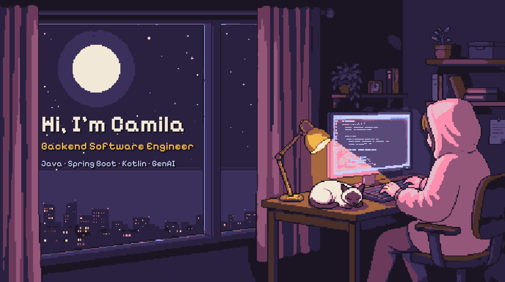

<h1 align="center">Hi, I'm Camila 🌸(●'◡'●)</h1>

  <b>Backend Software Engineer</b> from Buenos Aires, Argentina · Java, Spring Boot, Kotlin and GenAI
    
  <a href="https://camitermine.github.io"><b>🌐 Portfolio</b></a> ·
  <a href="https://camitermine.github.io/room.html"><b>🎮 Playable portfolio</b></a> ·
  <a href="https://www.linkedin.com/in/camila-termine"><b>💼 LinkedIn</b></a> ·
  <a href="mailto:camila.termine@gmail.com"><b>✉️ Email</b></a>

I build backends and client-server systems. I've written Java modules for a national HR system with more than 30,000 users, and today I design the persistence and state sync of a multiplayer game published by Team17 on Steam. I use GenAI across the whole development cycle, always with human review.

I'm looking for **Java or Kotlin backend roles** and **GenAI integration** work. Happy to talk in English or Spanish.

<h2>🛠 What I'm doing now</h2>

**Software Engineer at [Crisalu Games](https://store.steampowered.com/app/2748340/Goblin_Cleanup/)** (Aug 2025 – now)

- Designed from scratch the save and restore system for multiplayer sessions: serialization, checkpoints and rebuilding entities from the host's authoritative state, compatible across game versions.
- Cut reported desync bugs by **70%** by tracking down race conditions in real-time client-server state sync.
- Integrated Claude Code with Unity through the Model Context Protocol and built custom agents that review code before every pull request.

<h2>🔙 Before that</h2>

**Java Backend Developer at CONICET** (Sep 2024 – Oct 2025). Spring Boot and Hibernate modules for SIGERH, a national HR system: optimized SQL on a MySQL schema of more than 300 tables, built PDF reports with JasperReports, integrated external services and fixed production incidents every week.

Before coding, I spent more than ten years managing the archive of **CONICET Documental**: over 300 TB of footage for more than 35 documentaries, with zero data loss. That's where my obsession with never losing data comes from.

<h2>🚀 Featured projects</h2>

| Project | What it is | Stack |
|---|---|---|
| [**Steam Review Insights**](https://github.com/camitermine/steam-review-insights) | Spring Boot REST API that classifies 2,367 Steam reviews with Claude into bugs, feature requests, praise and other, across 24 languages. Weekly n8n summary to Discord. | Java 21, Spring Boot, PostgreSQL, Flyway, Testcontainers, Claude API |
| [**Salas de Estudio**](https://github.com/camitermine/salas-de-estudio) | RAG study assistant (in progress): each subject is a room with its own PDFs, and the chat answers only from those notes, citing document and page. Local embeddings, pgvector search filtered by room, Claude Haiku with Gemini fallback. | Python, FastAPI, PostgreSQL + pgvector, React, TypeScript, Claude API |
| [**Tic-Tac-Fade**](https://github.com/camitermine/tic-tac-fade) | Multiplayer tactical tic-tac-toe built with Claude Code and the Unity MCP. Pure C# domain module with 33 unit tests and ADRs. | C#, Unity, Claude Code, MCP |
| [**Pasaporte BA**](https://github.com/camitermine/Pasaporte-BA) | Check-in app for Buenos Aires. FastAPI backend whose persistence switches between MySQL and HBase per request (Repository + Factory). | Python, FastAPI, MySQL, HBase, Docker |
| [**Xpace**](https://github.com/camitermine/xpace) | Space expedition manager with a mission state machine and Strategy, Observer and Command patterns. CI and reviewed PRs. | Kotlin, Gradle, GitHub Actions |

<h2>💻 Tech stack \^o^/</h2>

**Backend** 

**Databases** 

**GenAI** 

**Testing & DevOps** 

**Frontend & client-server** 

